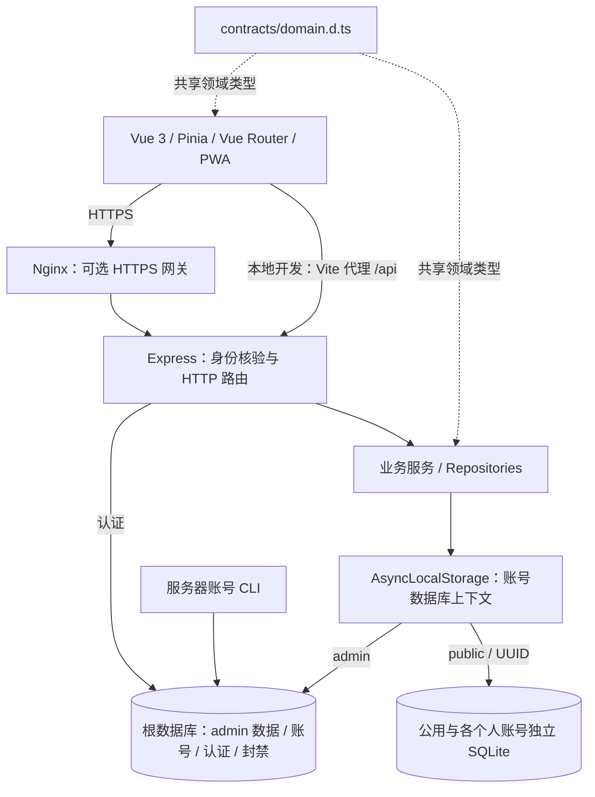
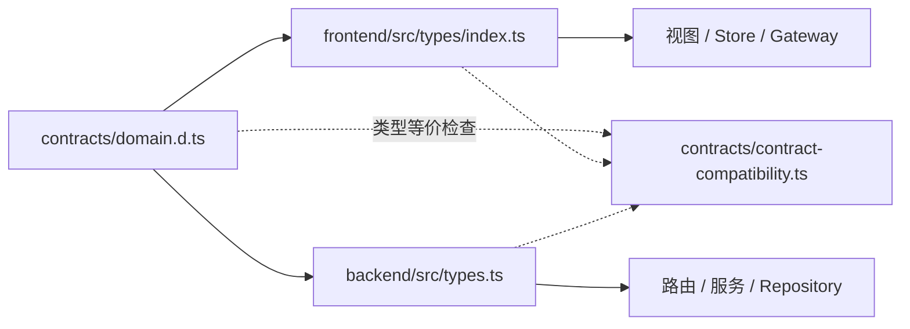

# 架构概览与阅读导航

Sacred Focus 是用于专注会话、目标管理与行为裁定的 Web/PWA。一个 Node.js/Express 进程提供 API 和生产前端静态文件，SQLite 按账号保存业务数据。浏览器可安装为 PWA；业务数据与账号核验依赖服务器，当前没有离线写入与合并队列。

默认访问进入共享的公用账号。管理员通过服务器 CLI 创建个人账号，网页没有注册入口；原单用户数据继续属于 `admin`。账号规则与操作见 [多人使用指南](multiuser.md)。

## 系统全景

实现入口是 [backend/src/app.ts:37](../backend/src/app.ts#L37)、[backend/src/db/connection.ts:27](../backend/src/db/connection.ts#L27) 和 [frontend/src/main.ts:22](../frontend/src/main.ts#L22)。详细的分层、请求身份与一致性机制见 [系统架构](architecture.md)，本页只保留概览和阅读入口。

## 技术与目录入口

| 位置 | 技术或用途 | 推荐阅读 |
|---|---|---|
| `frontend/` | Vue 3、Vite、Pinia、Vue Router；Vue Flow 提供国策画布，PWA 提供安装与静态资源缓存。 | [模块说明](modules.md#前端模块) |
| `backend/` | Node.js 22+、Express、better-sqlite3；路由、业务服务、repository 与账号数据库上下文。 | [系统架构](architecture.md) |
| `contracts/` | 不含运行时代码的 TypeScript 领域契约；两端类型入口重新导出并进行编译期等价断言。 | [API 与数据模型](api-and-data.md#共享领域对象) |
| `scripts/` | 镜像打包、全账号备份、容器更新与失败回滚、交付预检。 | [交付与运维手册](../scripts/README.md) |
| `Dockerfile`、`docker-compose*.yml`、`nginx/` | 应用镜像、资源配置、持久化挂载与可选 HTTPS 网关。 | [云服务器生产部署](cloud-production-deployment.md) |

具体依赖声明见 [frontend/package.json](../frontend/package.json) 和 [backend/package.json](../backend/package.json)，精确安装版本以 [package-lock.json](../package-lock.json) 为准，避免在概览中重复维护版本清单。

## 跨端类型如何对齐

共享对象包含 `AccountIdentity`、座位配置、专注日志、判例、国策图与演化状态。SQLite 行、JWT 载荷和框架对象留在各端内部；编译期类型检查不能代替 HTTP 输入与备份内容的运行时校验。源码见 [contracts/contract-compatibility.ts:14](../contracts/contract-compatibility.ts#L14) 与 [backend/src/types.ts:21](../backend/src/types.ts#L21)。

## 按任务继续阅读

| 任务 | 文档 |
|---|---|
| 理解账号隔离、revision 冲突、业务日与恢复边界 | [系统架构](architecture.md) |
| 找功能入口与模块职责 | [模块说明](modules.md) |
| 查看接口、数据路径、默认值与备份范围 | [API 与数据模型](api-and-data.md) |
| 配置开发环境、选择验证命令与维护文档 | [开发与验证](development.md) |
| 创建、停用和重置朋友账号 | [多人使用指南](multiuser.md) |
| 首次部署服务器与 HTTPS | [云服务器生产部署](cloud-production-deployment.md) |
| 更新已经运行的云服务器项目 | [云服务器项目更新步骤](cloud-server-update.md) |
| 查镜像、备份、更新脚本的参数与行为 | [交付与运维手册](../scripts/README.md) |

完整文档入口见 [文档索引](README.md)。
