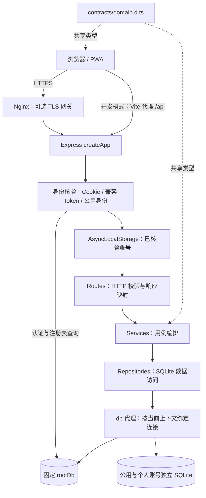

# 系统架构

本页记录稳定的分层、账号隔离与一致性边界。首次了解项目可先读 [架构概览](ARCHITECTURE_OVERVIEW.md)；接口与持久化字段见 [API 与数据模型](api-and-data.md)。

## 运行形态

Sacred Focus 是单体 Web/PWA：浏览器通过 `/api` 调用 Express，Express 使用同进程 SQLite 持久化数据。生产环境中 Express 同时托管 `frontend/dist`；可选 Nginx Compose overlay 在前面提供 HTTPS。开发环境由 Vite 代理 `/api` 到后端。PWA 缓存前端资源，业务读写仍依赖服务器。

## 分层与依赖规则

| 层 | 位置 | 职责 | 不应承担 |
|---|---|---|---|
| 共享契约 | `contracts/` | 可通过 HTTP 传递的领域类型及两端等价断言。 | SQLite 行、Express/Vue/Pinia 对象、运行时代码。 |
| 前端应用 | `frontend/src/application/` | API client、领域 gateway、同步协调和纯错误处理。 | 组件渲染、浏览器全局副作用。 |
| 前端平台 | `frontend/src/platform/browser/` | fetch、账号会话生命周期、主题、全屏、音频、下载和事件适配。 | 核心领域判定。 |
| 前端界面 | `views/`、`components/`、`stores/` | 呈现、交互、草稿和 UI 状态。 | 手写 HTTP 协议或访问数据库。 |
| HTTP 接入 | `backend/src/app.ts`、`routes/`、`middleware/` | 应用装配、输入检查、身份、限流及 HTTP 状态映射。 | SQL 与跨表业务算法。 |
| 业务服务 | `backend/src/services/` | 用例编排、revision 推进、认证与恢复顺序。 | Express 对象和 SQLite 单例依赖。 |
| 数据访问 | `backend/src/repositories/` | 注入数据库端口，封装查询、写入、事务与行模型转换。 | HTTP 响应和浏览器行为。 |
| 领域与基础设施 | `backend/src/domain/`、`db/`、`http/` | 纯领域校验与日历规则、数据库连接/迁移/种子、统一异常响应。 | UI 呈现和路由交互。 |

`frontend/src/utils/*`、`backend/src/db/dateUtils.ts`、`db/revision.ts`、`db/maintenance.ts` 与 `db/queries/focusTree.ts` 保留兼容入口，新逻辑应写入它们导向的应用、平台、领域或 repository 边界。`backend/src/db/queries/settlement.ts` 仍包含日结实现，不应将整个 `queries/` 目录描述为兼容门面。模块位置见 [模块说明](modules.md)。

## 启动与请求流程

| 入口 | 用途 | 源码 |
|---|---|---|
| `backend/src/server.ts` | 初始化根数据库、清理过期吊销项、创建监听；定期 checkpoint 并处理关闭。 | [startServer:41](../backend/src/server.ts#L41) |
| `backend/src/app.ts` | HTTP 组合根；装配中间件、路由和静态产物，不负责监听端口。 | [createApp:37](../backend/src/app.ts#L37) |
| `backend/src/db/index.ts` | 根数据库建表、迁移、最小状态及服务器账号表初始化。 | [initDatabase:7](../backend/src/db/index.ts#L7) |
| `frontend/src/main.ts` | Vue/Pinia/router 组合根；恢复主题并注册未授权、登出和跨标签页会话事件。 | [main.ts:22](../frontend/src/main.ts#L22) |
| `frontend/src/router/index.ts` | 首次导航静默核验服务端身份；公用账号也可访问功能页或主动打开登录页。 | [router/index.ts:53](../frontend/src/router/index.ts#L53) |

`createApp` 依次装配 Helmet、CORS、Cookie、15 MB JSON body、安全过滤，以及 `/api` 的 `no-store`、身份上下文、维护写保护、通用限流与容量限制。route 完成协议校验，service 编排用例，repository 读取或写入当前账号数据库。装配顺序见 [backend/src/app.ts:44](../backend/src/app.ts#L44)。

## 受控账号与数据库隔离

没有凭据时使用公用账号；它是所有访客共享的可写体验空间。管理员与个人账号通过登录取得 HttpOnly Cookie 会话，网页没有开放注册或账号管理 API。服务器 CLI 操作根数据库中的注册表：默认最多 20 个个人账号，停用账号仍计入，`admin/public` 不计入。停用、启用和重置个人密码都会增加 `sessionVersion`，使旧会话失效。实现见 [backend/src/cli/accounts.ts:64](../backend/src/cli/accounts.ts#L64) 与 [backend/src/repositories/accountRepository.ts:51](../backend/src/repositories/accountRepository.ts#L51)。

`rootDb` 始终指向 `DATA_DIR/app.db`，同时承载原 `admin` 业务数据、账号注册表、管理员密码哈希、JTI 吊销和 IP 封禁。公用及个人数据库按需在 `accounts/public/app.db` 或 `accounts/<UUID>/app.db` 打开并初始化。身份由服务器核验，客户端不能传路径或任意账号参数选择数据库。实现见 [backend/src/db/connection.ts:27](../backend/src/db/connection.ts#L27) 与 [backend/src/middleware/auth.ts:70](../backend/src/middleware/auth.ts#L70)。

业务 repository 注入的 `db` 是代理，每次方法调用绑定到 AsyncLocalStorage 中的账号连接；认证与封禁 repository 使用固定 `rootDb`。不能在跨请求对象中缓存由 `db.prepare()` 返回的 Statement，否则 Statement 会继续绑定创建时的账号。请求上下文持有连接直到响应完成或连接关闭；后台恢复另行保留上下文，直到事务和清理结束。公用/个人连接最多保留 8 个空闲连接，活跃连接不会因淘汰而被关闭；它不是总连接数限制。实现见 [backend/src/db/connection.ts:64](../backend/src/db/connection.ts#L64)、[connection.ts:82](../backend/src/db/connection.ts#L82) 和 [connection.ts:106](../backend/src/db/connection.ts#L106)。

SQLite 使用 WAL、外键与 5 秒 busy timeout，并通过 `max_page_count` 限制主数据库页数：默认公用 50 MiB、每个个人工作区及根数据库 256 MiB。配额不包含 WAL、预导入热备或服务器备份文件；账号数量与主数据库容量限制不能替代服务器总磁盘监控。达到页数上限后，业务写入可返回 507；删除与认证请求在预检查中豁免。实现见 [backend/src/db/connection.ts:15](../backend/src/db/connection.ts#L15)、[backend/src/config.ts:84](../backend/src/config.ts#L84) 和 [backend/src/middleware/accountLimits.ts:6](../backend/src/middleware/accountLimits.ts#L6)。

## 浏览器账号生命周期

一个页面生命周期固定属于一个核验后的账号。业务请求携带 `X-SF-Account-Id`，后端将它与 Cookie 身份比较；不一致时返回 401 `ACCOUNT_CHANGED`。它只防止旧页面误写，不能授予权限或切换数据库。浏览器适配器使用 `cache: no-store` 并校验响应仍属于当前会话。实现见 [frontend/src/platform/browser/api.ts:18](../frontend/src/platform/browser/api.ts#L18) 与 [backend/src/middleware/auth.ts:93](../backend/src/middleware/auth.ts#L93)。

登录、登出与账号变化会取消旧请求、广播同源标签页事件并重载页面，重新创建 store 与草稿。恢复浏览器缓存页或重新获得焦点时也会重建或核验身份；localStorage 的广播只记录变化事件，不保存账号或 JWT。公用计时使用当前标签页 sessionStorage；个人计时按账号与标签页分开使用 localStorage，日结提示也按账号隔离。实现见 [frontend/src/platform/browser/accountSession.ts:28](../frontend/src/platform/browser/accountSession.ts#L28)、[frontend/src/main.ts:30](../frontend/src/main.ts#L30) 和 [frontend/src/views/SacredSeatView.vue:46](../frontend/src/views/SacredSeatView.vue#L46)。

## 关键一致性边界

- **账号内 revision**：每个工作区自己的 `system_meta.system_revision` 负责同步探针和覆盖写的乐观并发控制。树全量保存、演化写操作、账号完整恢复携带 `expectedRevision`；不一致返回 409 `VERSION_CONFLICT` 和 `currentRevision`。不是所有单项 CRUD 都要求该字段。见 [backend/src/routes/focusTree.ts:29](../backend/src/routes/focusTree.ts#L29) 与 [backend/src/routes/evolution.ts:16](../backend/src/routes/evolution.ts#L16)。
- **草稿保护**：同步协调器每 60 秒及页面唤醒时探测当前账号状态；画布编辑期间观察远端 revision，避免自动覆盖本地草稿。见 [frontend/src/platform/browser/syncManager.ts:8](../frontend/src/platform/browser/syncManager.ts#L8) 与 [同步协调器](../frontend/src/application/sync/syncCoordinator.ts)。
- **业务日**：国策点亮和日结以 UTC+8 凌晨 04:00 分界；账号在读取国策树时执行日结，事务中二次核查已结算日期，冻结节点豁免断签归零。见 [backend/src/domain/calendar/businessDay.ts:7](../backend/src/domain/calendar/businessDay.ts#L7) 与 [backend/src/db/queries/settlement.ts:9](../backend/src/db/queries/settlement.ts#L9)。
- **演化快照**：每个账号固定 0–4 共 5 个环形槽位；架构导入与回滚在受控事务中完成。见 [演化 repository](../backend/src/repositories/evolutionRepository.ts)。
- **会话幂等**：日志 `id` 作为主键，重复提交同一日志不会重复累计连胜；批量日志导入按 ID 合并，语义与完成会话不同。见 [神圣座位服务](../backend/src/services/sacredSeatService.ts) 与 [神圣座位 repository](../backend/src/repositories/sacredSeatRepository.ts)。
- **默认文案迁移**：新账号初始化最新座位默认值；已有数据库通过 `migration:sacred_seat_defaults_v1` 仅替换已知旧信物和启动信号，保留自定义值、时长及连胜。根数据库在启动时迁移，其他账号在首次打开时迁移。心流目标是页面本次输入，默认为空，示例为“学习红黑树”。见 [backend/src/db/migrations.ts:60](../backend/src/db/migrations.ts#L60) 与 [API 默认值说明](api-and-data.md#默认值与兼容迁移)。

## 备份与恢复边界

页面中的完整备份仅包含当前账号的业务数据，不包含账号注册表、密码或服务器配置。公用账号可导出，但 `/api/system/import` 返回 403。个人或 `admin` 恢复先取得当前账号维护租约、创建其数据库的预导入热备，再用 SQLite 事务恢复业务数据；事务失败回滚，finally 释放租约。租约期间只拒绝该账号其他业务写请求，认证请求不受该写保护限制，其他账号可继续操作。实现见 [backend/src/routes/system.ts:27](../backend/src/routes/system.ts#L27)、[backend/src/services/systemBackupService.ts:43](../backend/src/services/systemBackupService.ts#L43) 与 [backend/src/middleware/maintenance.ts:7](../backend/src/middleware/maintenance.ts#L7)。

预导入物理快照保存在当前账号数据目录，默认保留最近 5 份；`admin` 快照因来自根数据库，也包含其注册表与安全元数据。服务器运维备份另行快照根数据库与所有已存在的账号数据库，并生成清单；在线方式取得各数据库独立一致快照，不是跨账号同一时刻的全局事务。范围和文件组成见 [API 与数据模型](api-and-data.md#备份边界)、[多人使用指南](multiuser.md) 和 [交付与运维手册](../scripts/README.md)。

## 安全与交付边界

服务器会核验 JWT、JTI 吊销、个人停用状态和 `sessionVersion`。旧管理员 JWT 保持向后兼容；已配置的静态 `APP_ACCESS_TOKEN` 仍映射到 `admin`。无凭据进入公用空间，携带失效凭据访问业务接口返回 401，状态接口允许回退公用空间并清理失效 Cookie。实现见 [backend/src/services/authService.ts:92](../backend/src/services/authService.ts#L92) 与 [backend/src/routes/auth.ts:79](../backend/src/routes/auth.ts#L79)。

Helmet、来源白名单、IP/UA 安全过滤及按 IP 的限流保护 HTTP 入口；公用与个人身份采用不同通用 API 限额。统一异常边界在生产模式中隐藏内部错误详情。基础 Compose 仅绑定回环地址；Nginx overlay 公开 80/443，并显式设置 `TRUST_PROXY=1`。生产 Cookie 要求 HTTPS。配置与运维步骤分别见 [云服务器生产部署](cloud-production-deployment.md)、[云服务器更新步骤](cloud-server-update.md) 与 [交付与运维手册](../scripts/README.md)。
